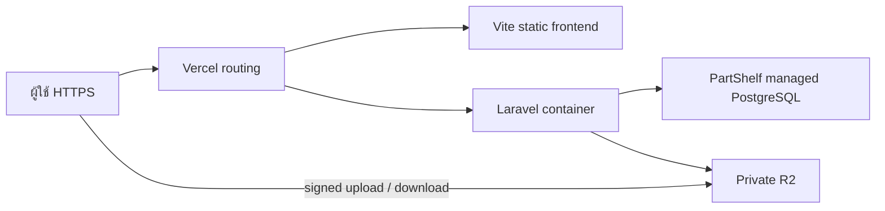

# PartShelf — แผนเตรียม Production

วันที่ตรวจ: 2026-10-28 (Asia/Bangkok)  
สถานะ: **DP01_LOCAL_VERIFIED — architecture/DP01 local อนุมัติแล้ว; cloud/deploy ยังไม่ได้อนุมัติ**  
ผู้จัดทำ: เลขาคิม, solo; ตรวจ source/docs แบบ read-only และบันทึกเอกสารใน PartShelf

## 1. ขอบเขตอำนาจและผลที่ต้องการ

Owner อนุมัติ Vercel Services/Container Beta + Neon + private R2 และเริ่ม DP01 เตรียม/ทดสอบ local แล้ว พร้อมสั่ง Git first commit/main/origin/push เมื่อ 2026-10-28 การสร้าง cloud resource, เพิ่ม cloud secret, เปิด billing, deploy Preview/Staging/Production, เปลี่ยน DNS และ migration cloud ยังต้องได้รับอนุมัติก่อนดำเนินการ

P00–P12 ของ local/test ยังคง DONE จากหลักฐานเดิมและ Owner UAT การปิด local MVP ไม่ได้แปลว่า production readiness ผ่านแล้ว DP01 เปลี่ยน application/production config และทดสอบใน local ตามคำอนุมัติ ดู `DP01_LOCAL_PREPARATION.md` และผลจริงใน `TEST_RESULTS.md`

## 2. สิ่งที่ตรวจพบจริง

| แหล่งหลักฐาน | ผลที่พบ | ผลต่อแผน |
|---|---|---|
| `frontend/package.json`, `frontend/vite.config.ts` | React/Vite/TypeScript; proxy `/api` และ `/sanctum` อยู่ใน Vite dev server | Production ต้องมี routing จริงก่อน SPA fallback; build เป็น static `dist` |
| `backend/composer.json`, `backend/Dockerfile` | Laravel 13, Sanctum, OpenSpout; PHP 8.4 Apache และ `pdo_pgsql`; image ยัง install dev dependencies | ต้องมี PHP runtime และ production container build; คง Laravel และ PostgreSQL |
| `backend/config/session.php`, `backend/config/cache.php` | ค่า default session/cache เป็น database | ใช้ shared DB ข้าม instance; ตรวจค่าที่เลือกจริงใน staging รวมถึง import confirmation token และ rate-limit counters |
| `ProductController.php`, `Product.php` | upload/delete/image URL ผูก disk `public` แบบ local โดยตรง | เปลี่ยนเฉพาะ default disk env อย่างเดียวไม่พอ ต้องแก้ทุก image read/write/delete path ให้ใช้ R2 และ signed read |
| `ProductExcelController.php` | XLSX upload 5,120 KiB; preview/confirm; export ใช้ temporary local file | ต้องออกแบบ transport สำหรับ upload/download ให้ผ่านข้อจำกัด host โดยคง validation/preview/confirmation |
| `backend/config/filesystems.php`, `backend/composer.json` | มี template S3 config แต่ยังไม่มี explicit Flysystem S3 dependency ใน require | ต้องเพิ่ม adapter และทดสอบ R2 จริงภายหลังอนุมัติ |
| `.git`, `vercel.json` | ไม่พบ Git repository และ deployment config ใน PartShelf | ต้องเลือกวิธี source/release tracking ก่อนสร้าง deployment; ยังไม่ init/commit/push |
| `scripts/restore-local-db.ps1` | ออกแบบสำหรับ Compose และสามารถ drop/recreate target local database | ห้ามใช้เป็น production restore runner; ต้องมี cloud recovery runbook แยก |

### LabSphere ที่ตรวจเพื่ออ้างอิง

อ่านไฟล์ `D:\git\LabSphere\vercel.json`, `apps\api\package.json`, `apps\api\src\storage.ts`, `docs\ONLINE-DEMO-DEPLOYMENT-REPORT.md`, และรายการที่เกี่ยวข้องใน `docs\ONLINE-DEMO-RUNBOOK.md` รวมถึงแชทชื่อ **พัฒนา Laboratory Management Platform** (thread `01a171de-7c61-7c20-969a-21ecc9097940`)

- LabSphere ใช้ Vite + Fastify/Node + Prisma/PostgreSQL; `vercel.json` มี API bridge และ SPA rewrites ใช้ API แบบเดียวกันทั้ง frontend/backend ได้
- รายงานวันที่ 2026-10-27 ระบุ Vercel Preview, Neon, private R2 และ online E2E ผ่าน สิ่งนี้เป็นหลักฐานจากรายงาน/ประวัติ ไม่ใช่ live inspection ของ account ในวันนี้
- Pattern ที่นำมาออกแบบได้: แยก env/resources, private bucket, signed upload/download, ตรวจ object หลัง upload, CORS แบบ exact origin และทดสอบ deployed URL ด้วย API จริง
- รายงานบันทึกปัญหา R2 credential อ่านได้แต่เขียนไม่ได้, signed metadata/checksum compatibility และ targetless deployment ถูกจัดเป็น Production โดยไม่คาดหมาย จึงต้องตรวจสิทธิ์และระบุ deployment target ชัดเจนทุกครั้ง
- LabSphere เป็น Demo/Preview และรายงานยังไม่ได้ provision provider backup retention/restore drill จึงไม่ถือว่าเป็น production template ที่พร้อมคัดลอก
- ไม่อ่านไฟล์ secret/private environment ไม่คัดลอก credentials, bucket, database, session, invitation gate, shared demo account หรือคำอนุมัติจาก LabSphere มาใช้ใน PartShelf

## 3. สถาปัตยกรรมที่เสนอ

**ทางเลือก A — ตรงตามความต้องการใช้ Vercel มากที่สุด:** static Vite frontend + Laravel PHP container ใน Vercel Services, managed PostgreSQL แยกสำหรับ PartShelf (เสนอ Neon เช่นเดียวกับ LabSphere), private Cloudflare R2 แยก staging/production

Vercel ระบุว่า Services รองรับหลาย frontend/backend และ Container Runtime รัน OCI images ได้ ทั้งสองยังเป็น **Beta** ต้องให้ Owner ยอมรับสถานะนี้และพิสูจน์ PHP/container ใน staging ก่อนเลือกเป็น production target ถ้าผลไม่ผ่าน ห้ามย้ายไปทางเลือกอื่นโดยอัตโนมัติ [Vercel Services](https://vercel.com/docs/services), [Container Runtime](https://vercel.com/docs/functions/runtimes/container)

**ทางเลือก B — หากไม่รับ Beta:** Vite อยู่ Vercel; Laravel อยู่ PHP/container hosting ที่ Owner เลือก; PostgreSQL และ R2 แยกเช่นเดิม ใช้ same-origin Vercel proxy หาก transport/auth ผ่านการทดสอบ หรือใช้ app/api subdomains บนโดเมนเดียวกันพร้อม explicit credentials/CORS หลังปรับ frontend ทั้งชุด โฮสต์ API และค่าใช้จ่ายของทางเลือกนี้ยังไม่เลือก

ไม่แนะนำ rewrite Laravel เป็น Node เพียงเพื่อคัดลอก LabSphere เพราะต้องยืนยัน stock transactions, row locks, idempotency, recount และ audit ใหม่ทั้งหมด

### Routing และ session

- เลือกหนึ่ง public origin สำหรับ app; ส่ง `/api/*` และ `/sanctum/*` ไป Laravel โดยรักษา path prefix; SPA fallback ทำงานหลัง route เหล่านี้ ตรวจ `/api/unknown` ต้องเป็น JSON 404 ไม่ใช่ `index.html`
- ตรวจ forwarded host/proto, HTTPS detection, proxy trust, Sanctum stateful domains, CSRF/XSRF และ cookie scope แบบ end-to-end; session cookie เป็น Secure/HttpOnly และใช้ชื่อเฉพาะ PartShelf
- หากแยก app/api origin ต้องอยู่โดเมนหลักเดียวกันและปรับ `credentials`/CORS ให้ครบ; preview URL สุ่มไม่ใช้เป็น production cookie domain [Laravel Sanctum SPA authentication](https://laravel.com/framework/docs/13.x/sanctum)
- API/auth/signed-URL responses ใช้ private/no-store; ไม่ให้ CDN เก็บ response ที่ผูกผู้ใช้ และคง PWA network-only

### PostgreSQL

- เสนอ database/project แยก PartShelf staging/production ไม่ใช้ Neon ของ LabSphere และไม่ upload local DB อัตโนมัติ
- Runtime ใช้ pooled connection หากผ่าน PDO/transaction compatibility; migration และ backup/restore ใช้ direct connection โดย role แยกสิทธิ์ เปิด TLS ตาม provider และเลือก region ใกล้ API [Neon connection pooling](https://neon.com/docs/connect/connection-pooling)
- ทดสอบ `lockForUpdate`, transaction advisory lock, decimal quantities, FKs, unique constraints, concurrent receipts/corrections และ rollback บน provider จริงก่อนอนุมัติ readiness
- ต้องกำหนด engine version ที่รองรับ schema ปัจจุบันจริง; PostgreSQL 17 local ไม่ได้ยืนยันว่า cloud version ถูกเลือกแล้ว

### R2 และการรับส่งไฟล์

- เสนอชื่อใหม่ `partshelf-staging-files` / `partshelf-production-files` (เป็นชื่อร่าง ยังไม่ตรวจ availability) และ token จำกัด bucket/environment แยกกัน ใช้ account เดิมได้เมื่อ Owner ยืนยัน target แต่ไม่ใช้ credentials ของ LabSphere
- Laravel ใช้ S3-compatible adapter; เพิ่ม `league/flysystem-aws-s3-v3` และ config เฉพาะ R2 หลังอนุมัติ [Laravel S3 driver](https://laravel.com/framework/docs/13.x/filesystem), [Cloudflare PHP SDK example](https://developers.cloudflare.com/r2/examples/aws/aws-sdk-php/)
- Bucket private; API ตรวจ auth/role ก่อนออก signed URL; signed GET อายุสั้นและ refresh เมื่อจำเป็น ไม่ใช้ `r2.dev` เป็น production asset endpoint [R2 public access](https://developers.cloudflare.com/r2/buckets/public-buckets/)
- Browser direct upload ต้องมี exact-origin CORS, allowed methods/headers ที่ตรงกับ signed request และทดสอบ expiry/denied origins [R2 presigned URLs](https://developers.cloudflare.com/r2/api/s3/presigned-urls/), [R2 CORS](https://developers.cloudflare.com/r2/buckets/cors/)
- สร้าง upload intent ผูก user/type/key/expiry; key สุ่มและไม่ใช้ user path ตรง ๆ; หลัง upload ตรวจ bytes, ขนาด, MIME จริง/ชนิดรูปหรือ XLSX และ checksum ก่อนผูก product/เปิด preview; client-declared MIME/HEAD metadata อย่างเดียวไม่พอ ห้าม replay object ไปใช้กับ user อื่น
- Image validation 5,120 KiB และ XLSX 5,000 rows/preview/one-use confirm ต้องยังอยู่ ถ้าต้องลดขนาด limit ถือเป็นการเปลี่ยน behavior ที่ Owner ต้องรับทราบ
- ส่ง XLSX export ขนาดใหญ่เป็น private R2 temporary object แล้วออก signed download; temporary uploads/exports มี lifecycle แยกจาก permanent product images; ไม่ตั้ง expiry เหมารวมทั้ง bucket

**เหตุผลที่ต้องเปลี่ยน file transport:** source รับ image/XLSX ได้ประมาณ 5 MiB แต่ Vercel Functions กำหนด request/response payload 4.5 MB และ Container Runtime ใช้ Functions limits เช่นกัน ต้องทดสอบทั้งขอบเขตขนาดและ multipart overhead แทนการคัดลอก limit เดิมลง server [Functions limits](https://vercel.com/docs/functions/limitations), [Container limits](https://vercel.com/docs/functions/runtimes/container)

## 4. งานเตรียม source และ environment หลังอนุมัติ

| งาน | ผลลัพธ์ที่ต้องทำ | เกณฑ์ผ่าน |
|---|---|---|
| Release identity | เลือก private Git workflow หรือ immutable source archive+SHA256; exclude `.env`, node_modules/vendor, dumps, test results/browser cache และ `.kimmizo` private runtime | build ระบุ source revision และ reproduce ได้; Owner อนุมัติก่อน Git remote/push |
| Frontend build | `frontend` เป็น service root; `npm ci` / `npm run build`, output `dist`; Node 24 ที่พิสูจน์แล้ว | ใช้ static build ไม่มี Vite dev server ใน production |
| PHP container | ปรับ production image; `composer install --no-dev --prefer-dist --optimize-autoloader`; PHP extensions/OpenSpout; writable temp/framework dirs, stdout logs, public document root | startup ไม่มี migration/seed; เปิด HTTP port ตาม runtime; ไม่มี Compose bind volume dependency |
| R2 storage | configurable image disk, authorized signed image URLs, upload intent/confirm, deletion/cleanup retry และ exports | รูปยังอ่านได้หลัง replace/redeploy; rollback source ยังอ่าน object keys ได้ |
| Secrets/config | `APP_ENV=production`, `APP_DEBUG=false`, unique stable `APP_KEY`; DB credentials/TLS, session/cache settings, R2 endpoint/keys/bucket | backend-only secrets; ไม่มี secret ใน `VITE_*`, frontend bundle, logs หรือ source; แยก Preview/Production |
| State และ jobs | session/cache/import token shared DB; async cleanup/reconciliation มี runner ที่กำหนดชัด | cold start/หลาย instance ไม่ทำ token หรือ session หาย; มีวิธี retry cleanup ไม่ orphan files เงียบ ๆ |
| Runtime constraints | วัด cold start, timeout, memory, writable tmp, payload และ worst-case 5,000-row XLSX | อยู่ใน limits ของแผนที่เลือก; หากไม่ผ่านให้ review architecture ก่อน deploy production |
| Operations | health/readiness, redacted logs, alerts, backup+restore, incident owner | ตรวจพบ DB/R2 failure ได้และมี recovery evidence จริง |

APP_KEY ต้องเก็บคงที่ข้าม release; ไม่ generate ใหม่ทุก build ส่วน migration ใช้ controlled release job ที่ระบุ target ชัด ไม่รันใน build/ทุก cold start

## 5. ลำดับงานและ approval gates

| ขั้น | สถานะปัจจุบัน | งานและเงื่อนไข |
|---|---|---|
| DP00 — แผนและหลักฐาน | APPROVED | Owner เลือก Vercel Services/Container Beta + Neon + private R2 |
| DP01 — เตรียมใน local | DONE | Production config/container, private S3 transport, auth guard, tests และ protected review ผ่านใน local; ดู `TEST_RESULTS.md`; cloud compatibility ยังไม่ยืนยัน |
| DP02 — Provision staging | REQUIRES_APPROVAL | ยืนยัน account/team/region/budget; สร้าง project/DB/bucket/token สำหรับ PartShelf; secret เข้า provider แบบส่วนตัว |
| DP03 — Deploy staging และพิสูจน์ | REQUIRES_APPROVAL | ระบุ target/environment และ readback ให้ตรง staging/preview; ไม่ใช้ targetless deploy; migrations เฉพาะ DB staging; browser/API/R2 จริงไม่ mock |
| DP04 — Production readiness | NOT_STARTED | ส่ง release manifest, source/build identity, actual staging results, resource IDs, env names (ไม่มีค่า secret), restore evidence, cost/limits และ rollback plan ให้ Owner review |
| DP05 — Deploy production | REQUIRES_EXPLICIT_OWNER_APPROVAL | อนุมัติ release+targets+migration+domain+budget ที่แน่นอน; backup ก่อน migration; deploy/health check ก่อนเปลี่ยน public traffic เมื่อ platform รองรับ |
| DP06 — หลังเปิดใช้งาน | NOT_STARTED | smoke test ด้วย non-demo account, monitor errors/DB connections/R2 failures, ยืนยัน backup schedule และบันทึกผลตามจริง |

การอนุมัติแผนไม่เท่ากับอนุมัติ provision/deploy ทุกขั้น ต้องระบุขอบเขตที่อนุมัติ แผนนี้ยังไม่มี cloud execution ใด ๆ

## 6. Acceptance ก่อนเสนอเปิด Production

เกณฑ์ cloud ต่อไปนี้ยัง **NOT_RUN**; DP01 local verification ล่าสุดเป็น 66 tests/354 assertions, local-S3 integration 1/18, browser 2 scenarios และ production-container smoke ตาม `TEST_RESULTS.md` ผลเหล่านี้ไม่ใช่ cloud readiness

1. CI/local candidate: meaningful regression tests, lint/typecheck/build/audits; image และ config ตรวจ secret leakage; release traceable
2. Staging URL ด้วย browser ใหม่และ API/DB จริง: login/logout, bad CSRF, session cookie, all roles, deep links/API404, rate limit และ no-store; ไม่มี shared demo login
3. Product/location/stock/count/import/export จริง: duplicate SKU, count zero, recount history, receipts during count, idempotency replay, simultaneous corrections และ nonnegative balance
4. R2 จริง: signed PUT/GET, byte integrity, unsupported MIME, exact origins, expiry, unauthorized/replayed intent, replacement/deletion rollback, cleanup; ไม่มี public bucket หรือ key ใน browser bundle
5. Payload ขอบเขต 5,120 KiB image/XLSX, malformed archive, row limit และ export ใหญ่; เส้นทางผ่าน R2 ไม่ชน Functions payload/timeout/memory limit
6. Cold start/redeploy/หลาย instance: session, cache-backed preview token และ rate limit ยังถูกต้อง; temporary file cleanup ทำงาน
7. HTTPS/PWA/install/camera/USB/label printer ทดสอบบน device ที่ Owner ใช้จริง และ DB/R2 outage ไม่เปิดเผย stack trace
8. Backup และ restore ของ cloud DB และ file recovery ไป isolated destination; ตรวจ schema/row counts/stock invariants+object references; ไม่ restore ทับ production เพื่อทำ drill
9. Monitoring/cost thresholds และ rollback rehearsal ผ่าน; Owner signoff ผูกกับ production candidate นี้โดยเฉพาะ

## 7. Backup, cutover และ rollback

- เสนอ RPO ไม่เกิน 24 ชั่วโมง และ RTO ไม่เกิน 4 ชั่วโมงเป็นเป้าหมายร่าง ต้องให้ Owner รับรองและทดสอบได้จริงก่อนรับประกัน
- เลือก provider backup/PITR retention ที่รองรับงบ; มี encrypted access-controlled backup และ isolated restore drill; R2 ต้องมีแผนกู้ object จากการลบที่ทดสอบแล้ว ไม่ถือว่า object storage เป็น backup โดยตัวมันเอง
- ก่อน migration: target DB readback, backup validation, maintenance/write policy และ owner checklist; ใช้ backward-compatible expand/contract และไม่ destructive drop ใน initial release
- Source rollback ใช้ known-good deployment พร้อม schema ที่รองรับ; ไม่ `migrate:rollback` อัตโนมัติเมื่อมีข้อมูลใหม่ หากเสียหายให้หยุด writes และ restore ไป DB ใหม่เพื่อตรวจ/สลับอย่างควบคุม
- ไฟล์รูปเดิมและ object key format ต้องรองรับ source rollback; cleanup มี grace period ไม่ลบ permanent files ตาม release โดยทันที
- Local restore scripts เป็น reference ของ local drill เท่านั้น; cloud recovery ต้องใช้ direct cloud connection/สิทธิ์เฉพาะและอนุมัติ target แยก

## 8. ข้อมูลที่ Owner ต้องเลือกก่อนเดินหน้าฝั่ง cloud

| รายการ | ข้อเสนอ / สิ่งที่ยังไม่ทราบ |
|---|---|
| API hosting | A: Vercel Container/Services Beta อนุมัติแล้ว โดยมี staging gate; B เป็น fallback ที่ต้องขออนุมัติใหม่หากเปลี่ยน architecture |
| Domain | ยังไม่ระบุ; ต้องเลือก app origin/staging origin และผู้ถือ DNS |
| Team/accounts | ใช้บัญชี Vercel/Cloudflare เดิมได้เมื่อยืนยันสิทธิ์ แต่สร้าง resource ของ PartShelf แยก |
| Database | เสนอ Neon managed PostgreSQL ใหม่; ต้องยืนยัน region, version, backup retention และแผนราคา |
| Budget | ยังไม่ระบุเพดานรายเดือน; คำนวณ Vercel compute/traffic + DB/storage/backup + R2 storage/operations + domain/monitoring/optional API host |
| Commercial use | งานร้านค้าควรจัดงบ Vercel plan ที่รองรับ commercial use; Hobby จำกัด personal/non-commercial ตามเอกสาร ไม่คัดลอก Hobby Demo ของ LabSphere [Vercel Hobby](https://vercel.com/docs/plans/hobby) |
| Data cutover | ยังไม่ทราบว่าจะเริ่มฐานว่างหรือย้ายข้อมูล local; ต้องสำรวจยอดจริงใหม่เมื่ออนุมัติ ไม่ถือว่ายอด 0 จาก UAT ยังเป็นปัจจุบัน |
| Owner account | วิธี provision/handoff บัญชีจริงผ่านช่องทางส่วนตัว; ไม่มี demo seed/password ใน source |

ราคาจริง สิทธิ์ account/feature, cloud resource state, domain ownership และ runtime compatibility ยังไม่ตรวจ live รอบนี้ เมื่อ Owner เลือกทางสถาปัตยกรรมและอนุมัติขอบเขตถัดไปจึงทำ preflight จริงและบันทึกหลักฐานก่อนดำเนินการ
